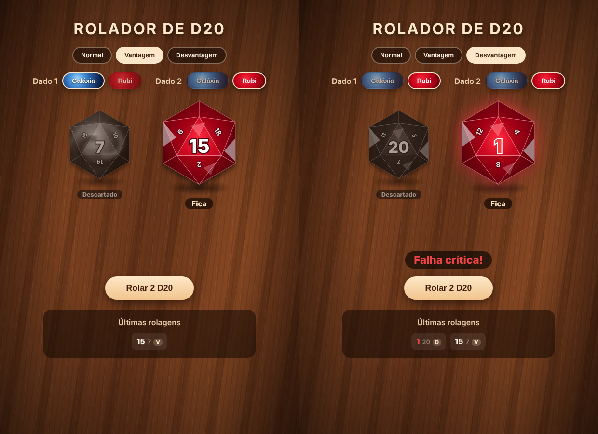

# Rolador de D20 com testes BDD


Simulador de um dado de 20 faces (D20), como os usados em RPG de mesa, feito em **Next.js/React** e testado com **BDD**: o comportamento esperado está descrito em **Gherkin, em português**, e é automatizado com **Cucumber + Playwright**.

**[▶ Usar agora no navegador](https://jaofraccaroli.github.io/dado-d20-bdd/)** · **[⬇ Baixar o app Android (APK)](https://github.com/JaoFraccaroli/dado-d20-bdd/releases/download/app-android/rolador-d20.apk)**


## Visual

Inspirado em dois dados de verdade sobre uma mesa de madeira: o dado aparece visto de cima, com a face sorteada no centro e as faces vizinhas em volta. Dá para escolher entre dois modelos:

- **Galáxia**: núcleo azul-claro, braços azuis e estrelas, como uma galáxia espiral
- **Rubi**: vermelho profundo lapidado, com reflexos brancos como uma pedra preciosa

## Vantagem e desvantagem

Além do modo **Normal** (um dado), dá para rolar **dois D20 de uma vez**:

- **Vantagem**: fica o maior resultado
- **Desvantagem**: fica o menor resultado

Os dois resultados aparecem: o dado que fica ganha um leve zoom e o selo "Fica", e o outro fica **cinza** com o selo "Descartado". Cada dado tem o seu modelo, então dá para rolar dois Galáxia, dois Rubi ou um de cada. No histórico aparece o resultado que ficou, o descartado riscado e a marcação V ou D.



## Regras

- Clicar em **Rolar D20** sorteia um número de 1 a 20, com uma animação curta.
- Os números são brancos, como no dado real.
- **20** aparece em **verde**, com a mensagem "Acerto crítico!".
- **1** aparece em **vermelho**, com a mensagem "Falha crítica!".
- Nos dois casos o número ganha contorno branco e o dado brilha, para o 1 vermelho continuar visível no dado Rubi.
- As **10 últimas rolagens** ficam no histórico, a mais recente primeiro, com as mesmas cores.
- Quem configurou o sistema para "reduzir movimento" vê o resultado sem animação (acessibilidade).

## Como testar algo aleatório?

Não dá para escrever "Então o resultado deve ser 20" se o dado sorteia um número diferente a cada vez. A solução usada aqui é **controlar o sorteio no teste**: o Page Object substitui o `Math.random` da página antes da rolagem, forçando o resultado que o cenário precisa. Com dois dados, ele recebe uma fila de valores (o primeiro para o dado 1, o segundo para o dado 2).

```gherkin
Cenário: Tirar 20 é um acerto crítico com o número em verde
  Dado que o próximo resultado do dado será 20
  Quando eu rolo o dado
  Então o resultado deve ser 20
  E o número deve aparecer em verde
  E deve aparecer a mensagem "Acerto crítico!"
```

Para o sorteio de verdade, um cenário rola o dado **100 vezes** sem controle e confere que todos os resultados ficam entre 1 e 20 e que saiu mais de um valor diferente.

## Cenários

Arquivos [`features/dado.feature`](features/dado.feature) e [`features/vantagem_desvantagem.feature`](features/vantagem_desvantagem.feature), 27 execuções no total.

Um dado:

| Cenário | O que verifica |
|---|---|
| Antes da primeira rolagem | Dado mostra "?" e histórico vazio |
| Tirar 20 | Número verde e mensagem de acerto crítico |
| Tirar 1 | Número vermelho e mensagem de falha crítica |
| Modelo inicial | O dado começa no modelo Galáxia |
| Regras de cor nos dois modelos | 1 vermelho e 20 verde também no dado Rubi |
| Resultados comuns (2, 10 e 19) | Número branco e nenhuma mensagem de crítico |
| Histórico em ordem | Mais recente primeiro, com as cores certas |
| Limite do histórico | No máximo 10 rolagens guardadas |
| 100 rolagens | Todos os resultados entre 1 e 20 |

Dois dados:

| Cenário | O que verifica |
|---|---|
| Quantidade de dados | 1 dado no modo normal, 2 na vantagem e na desvantagem |
| Vantagem com 7 e 15 | Os dois aparecem, fica o 15 em destaque e o 7 cinza |
| Desvantagem com 7 e 15 | Fica o 7 em destaque e o 15 cinza |
| Vantagem com 1 e 20 | Acerto crítico verde, 1 descartado |
| Desvantagem com 1 e 20 | Falha crítica vermelha, 20 descartado |
| Empate (12 e 12) | Um dado fica e o outro é descartado |
| Modelo de cada dado | Galáxia + Galáxia, Rubi + Rubi e as duas misturas |
| Histórico | Mostra o resultado que ficou e o descartado |
| 100 rolagens em cada modo | O resultado é sempre o maior (vantagem) ou o menor (desvantagem) |

Para conferir que os testes pegam erros de verdade, foi feito um teste de mutação manual: trocar a regra do crítico de 20 para 19 faz 3 cenários falharem, e inverter a regra da vantagem faz outros 4 falharem.

## Estrutura

```
features/
├── dado.feature                  # cenários de um dado
├── vantagem_desvantagem.feature  # cenários de dois dados
├── step_definitions/
│   └── dado.steps.js             # ligação entre as frases e o código
└── support/
    ├── hooks.js                  # abre e fecha o navegador
    └── pagina-dado.js            # Page Object (inclui o controle do sorteio)
components/DadoD20.js             # desenho do D20 em SVG
lib/dado.js                       # sorteio, crítico/falha e vantagem/desvantagem
public/                           # manifest, service worker e ícones do PWA
capacitor.config.json             # configuração do app Android
pages/index.js                    # página do dado
styles/                           # visual
```

## Use no celular

O rolador funciona como app no celular, inclusive **sem internet**.

**Android, pelo APK**
1. No celular, abra o link [rolador-d20.apk](https://github.com/JaoFraccaroli/dado-d20-bdd/releases/download/app-android/rolador-d20.apk) e baixe o arquivo.
2. Abra o arquivo baixado. O Android vai pedir para **permitir a instalação de apps desta fonte**: permita e toque em **Instalar**.
3. O app "Rolador de D20" aparece na tela inicial.

**Qualquer celular, pelo navegador (PWA)**
1. Abra [jaofraccaroli.github.io/dado-d20-bdd](https://jaofraccaroli.github.io/dado-d20-bdd/) no Chrome (Android) ou no Safari (iPhone).
2. No menu do navegador, toque em **Instalar app** ou **Adicionar à tela inicial**.

### Como isso foi feito

- **PWA**: o Next.js gera uma versão estática do site (`output: "export"`), publicada no **GitHub Pages** a cada push. Um `manifest.webmanifest` define nome, ícones e cores, e um **service worker** (`public/sw.js`) guarda os arquivos para o app abrir offline.
- **APK**: o **Capacitor** coloca o mesmo site dentro de um app Android. O GitHub Actions monta o projeto Android, gera o ícone e a tela de abertura e compila o APK, que fica disponível na página de **Releases**. A chave de assinatura é sempre a mesma (`android-keystore/`), então uma versão nova instala por cima da antiga.
- Os ícones são gerados por código: `scripts/gerar_icones.py`.

## Como rodar

```bash
npm install
npm run dev          # abre em http://localhost:3000
```

Testes:

```bash
npx playwright install chromium
npm test             # sobe a aplicação e roda os cenários
```

O relatório fica em `reports/relatorio-cucumber.html`. No GitHub Actions os cenários rodam a cada push, e o relatório fica nos artefatos da execução.

## Histórico

O projeto começou como um contador simples em React e virou um rolador de D20.
