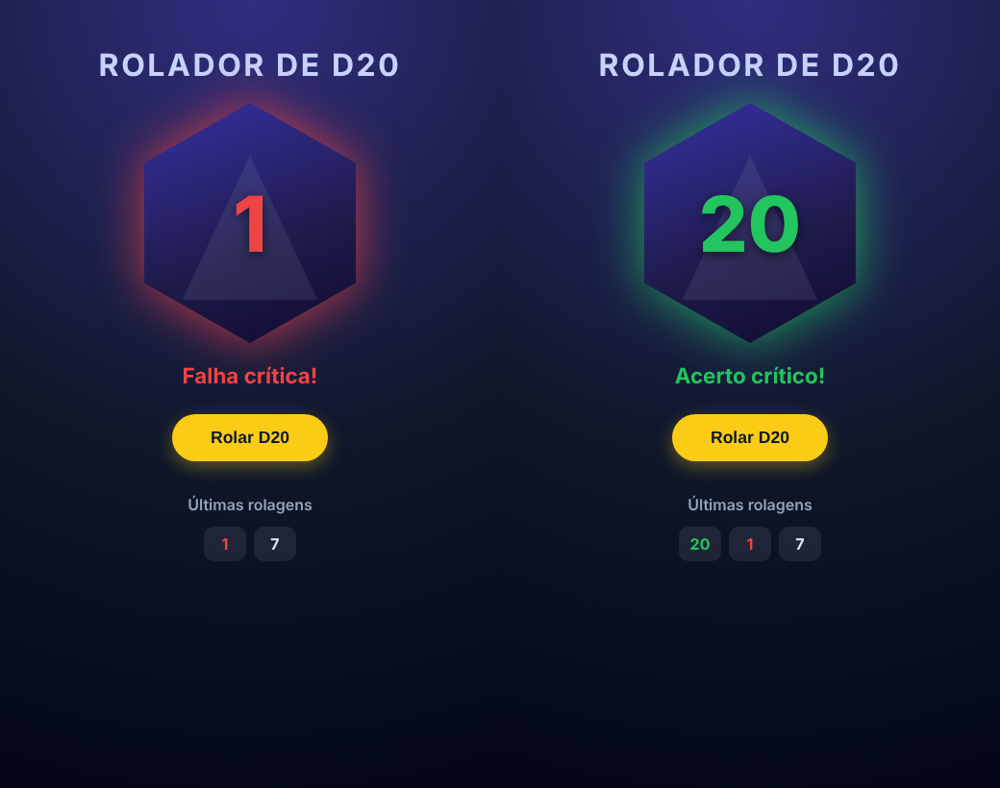

# Rolador de D20 com testes BDD


Simulador de um dado de 20 faces (D20), como os usados em RPG de mesa, feito em **Next.js/React** e testado com **BDD**: o comportamento esperado está descrito em **Gherkin, em português**, e é automatizado com **Cucumber + Playwright**.



## Regras

- Clicar em **Rolar D20** sorteia um número de 1 a 20, com uma animação curta.
- **20** aparece em **verde**, com a mensagem "Acerto crítico!".
- **1** aparece em **vermelho**, com a mensagem "Falha crítica!".
- As **10 últimas rolagens** ficam no histórico, a mais recente primeiro, com as mesmas cores.
- Quem configurou o sistema para "reduzir movimento" vê o resultado sem animação (acessibilidade).

## Como testar algo aleatório?

Não dá para escrever "Então o resultado deve ser 20" se o dado sorteia um número diferente a cada vez. A solução usada aqui é **controlar o sorteio no teste**: o Page Object substitui o `Math.random` da página antes da rolagem, forçando o resultado que o cenário precisa.

```gherkin
Cenário: Tirar 20 é um acerto crítico com o número em verde
  Dado que o próximo resultado do dado será 20
  Quando eu rolo o dado
  Então o resultado deve ser 20
  E o número deve aparecer em verde
  E deve aparecer a mensagem "Acerto crítico!"
```

Para o sorteio de verdade, um cenário rola o dado **100 vezes** sem controle e confere que todos os resultados ficam entre 1 e 20 e que saiu mais de um valor diferente.

## Cenários

Arquivo [`features/dado.feature`](features/dado.feature), 9 execuções no total:

| Cenário | O que verifica |
|---|---|
| Antes da primeira rolagem | Dado mostra "?" e histórico vazio |
| Tirar 20 | Número verde e mensagem de acerto crítico |
| Tirar 1 | Número vermelho e mensagem de falha crítica |
| Resultados comuns (2, 10 e 19) | Cor normal e nenhuma mensagem de crítico |
| Histórico em ordem | Mais recente primeiro, com as cores certas |
| Limite do histórico | No máximo 10 rolagens guardadas |
| 100 rolagens | Todos os resultados entre 1 e 20 |

Para conferir que os testes pegam erros de verdade, foi feito um teste de mutação manual: trocar a regra do crítico de 20 para 19 faz 3 cenários falharem.

## Estrutura

```
features/
├── dado.feature                  # cenários em português
├── step_definitions/
│   └── dado.steps.js             # ligação entre as frases e o código
└── support/
    ├── hooks.js                  # abre e fecha o navegador
    └── pagina-dado.js            # Page Object (inclui o controle do sorteio)
lib/dado.js                       # sorteio e regra de crítico/falha
pages/index.js                    # página do dado
styles/                           # visual
```

## Como rodar

```bash
npm install
npm run dev          # abre em http://localhost:3000
```

Testes:

```bash
npx playwright install chromium
npm test             # sobe a aplicação e roda os cenários
```

O relatório fica em `reports/relatorio-cucumber.html`. No GitHub Actions os cenários rodam a cada push, e o relatório fica nos artefatos da execução.

## Histórico

O projeto começou como um contador simples em React e virou um rolador de D20.
